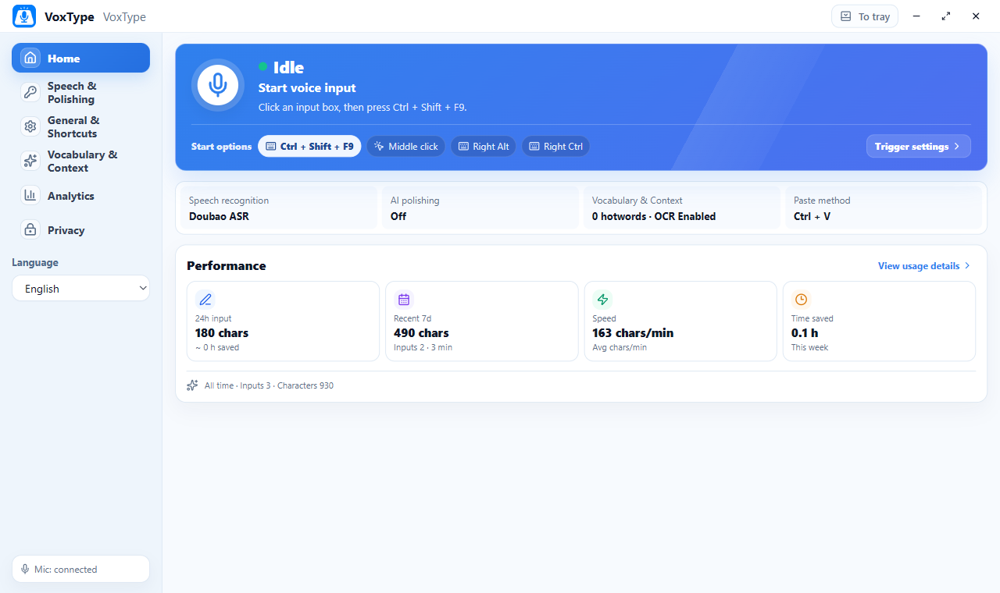

# VoxType

[简体中文](README.md) · [Wiki](https://github.com/zkwi/VoxType/wiki) · [Setup guide](docs/wiki/Setup-Guide-English.md)

## 1. Windows voice typing

VoxType is an open-source Windows desktop dictation app. Put the cursor in a text field, start speaking, and finish the recording to insert the result into the active app.

`Shortcut, Right Alt, Right Ctrl, or middle click → streaming ASR → optional LLM editing → clipboard paste and restore`

- **Live feedback.** Floating captions show interim text, processing state, and errors. Output waits for the speech provider's final result.
- **Optional editing.** Insert short dictation directly or use your configured language model to polish longer passages.
- **Vocabulary and context.** Add hotwords and writing context, and use Windows OCR from the screen or active window when useful.
- **Native output.** Choose automatic paste or clipboard-only output. VoxType tries to restore the previous clipboard after pasting.
- **Local controls.** You manage the credentials and settings. Usage stats store metrics such as character count, duration, and speed.



## 2. Quick start in three steps

1. **Install and open VoxType.** Download the latest Windows x64 installer, `VoxType_*_x64-setup.exe`, run it, then open VoxType from the Start menu. VoxType supports Windows 10 and 11. [Download the installer](https://github.com/zkwi/VoxType/releases/latest)
2. **Connect a speech service.** In Speech & Polishing, choose Doubao streaming ASR or Alibaba Cloud Bailian FunASR, enter your provider credentials, and test the connection. The speech console's single API Key is recommended for Doubao. [Setup guide](docs/wiki/Setup-Guide-English.md)
3. **Dictate.** Focus a text field and press `Ctrl + Q` to start speaking. Press it again to stop. VoxType outputs the final text using the selected paste method. Right Alt, Right Ctrl, and middle click are available in General & Shortcuts.

The microphone status, triggers, and settings summary on Home open their respective settings. Choose **View usage details** to open Analytics. The Home footer shows the lifetime counts from local usage history.

### Microphone and first input

- Allow desktop apps to access the microphone in Windows Settings → Privacy & security → Microphone.
- If you have multiple microphones, select one in General & Shortcuts → Microphone. Refresh the list after connecting or reconnecting a device.
- Try your first dictation in a plain-text editor to see the caption and final output.
- If the connection test passes and no text is inserted, check whether the target app allows paste. You can also select clipboard-only output and paste manually.

### Main window and tray

The minimum main-window size is `960 × 640`. Closing the window hides it to the tray by default, where enabled recording triggers remain available.

| Action | Result |
| --- | --- |
| Left-click the tray icon | Open or restore the main window |
| Choose **Open main window** from the tray menu | Restore the window from the tray |
| Choose **Check updates** | Open the window and check for a newer release |
| Choose **Exit** | Close VoxType |
| Trigger recording from the tray before configuring ASR | Open Speech & Polishing |

General & Shortcuts includes the window close behavior and launch at Windows sign-in. A configured app can stay in the tray when launched at sign-in.

See the troubleshooting guide for installation, permissions, or connection issues. [Troubleshooting](docs/wiki/Troubleshooting-English.md)

### Reading input feedback

| Feedback | What to do |
| --- | --- |
| Home says setup is required | Fill in and test the current provider's credentials in Speech & Polishing |
| Interim text appears in the caption | Keep speaking and wait for final output after stopping |
| The caption reports a microphone startup failure | Check Windows permissions or the input device, then retry |
| VoxType says it copied the text | Press `Ctrl + V` if the target app did not paste it |

## 3. Configuration at a glance

### Speech & Polishing

| Service | In-app settings |
| --- | --- |
| Doubao speech console API Key | Enter the API Key from the new speech console |
| Legacy Doubao console | Enter the App Key and Access Key |
| Volcengine Ark Agent Plan | Enter the dedicated Agent Plan API Key and use the fixed resource plan |
| Alibaba Cloud Bailian FunASR | Enter the API Key and Workspace ID, and choose settings for your account's region |
| Optional LLM editing | Enter an OpenAI-compatible Base URL, API Key, and model name |

For standard Doubao access, select the hourly or concurrent resource plan available on your account under advanced ASR settings. Each authentication mode keeps its own credentials.

Speech recognition is enough for basic dictation. Under Speech & Polishing → AI polishing, you can test the model connection, enable polishing, and set its minimum length. In Vocabulary & Context, you can edit the system prompt and user prompt template, preview the prompt, or restore the default.

### Recording triggers and output

| Setting | Default | How it works |
| --- | --- | --- |
| Main shortcut | On, `Ctrl + Q` | Record another combination or switch it off |
| Right Alt | Off | Release Right Alt to toggle recording when enabled |
| Right Ctrl | Off | Release Right Ctrl to toggle recording when enabled |
| Middle mouse | Off | Press the middle button to toggle recording when enabled |
| Paste method | `Ctrl + V` | Also supports `Shift + Insert` and clipboard-only output |
| Restore clipboard after paste | On | VoxType tries to restore the previous contents |
| Mute system audio during recording | Off | Enable in Microphone settings to mute until recording ends |

Backup triggers pause while you capture a new main shortcut. They resume when capture ends or loses focus.

VoxType takes over each enabled extra trigger. With Right Ctrl enabled, Left Ctrl still works for copying, pasting, and the main shortcut. Turn off the Right Ctrl switch to use Right Ctrl combinations in other apps again.

A valid shortcut combination is saved automatically. Press Esc or use Tab to move focus and keep the previous shortcut. Tab combinations with modifiers can be recorded.

### Vocabulary, writing context, and screen OCR

- **Hotwords** help with names, product names, acronyms, and technical terms.
- **Writing context** describes preferences and use cases such as support tickets or meeting notes.
- **Screen OCR** is on by default. Under Vocabulary & Context → Screen text context, you can change the capture scope, preview a test, turn OCR off, or adjust the character limit in advanced settings.
- **Recent context** is off by default. Enable it for continuous dictation, with a separate switch for LLM use.
- **Automatic hotword candidates** are off by default. When enabled, local history can be used to generate candidates for you to review.

The app saves settings automatically. Consult the example config and feature guide for advanced parameters and their allowed values. [Example config](config.example.toml) · [Feature guide](docs/wiki/Feature-Guide-English.md)

### Choosing settings for your workflow

- For short messages, you can use ASR on its own. For meeting notes, enable LLM editing and set the minimum length to suit your dictation.
- If another app uses `Ctrl + Q`, record a different combination or enable a single extra trigger.
- Use display OCR when you dictate with reference material visible. Limit OCR to the active window when it contains all the relevant context.
- Try clipboard-only output in remote desktops and apps that restrict automatic paste.

## 4. Privacy and local data

These are the default locations for installed builds. Existing config or stats files can keep their previous locations. See Privacy & local data for the locations in use.

| Data | Default location | Contents and defaults |
| --- | --- | --- |
| Config | `%APPDATA%\VoxType\config.toml` | Settings and any API credentials entered by the user |
| Logs | `%LOCALAPPDATA%\VoxType\logs\voice_input.log` | Redacted events, excluding transcripts and raw credentials |
| Usage stats | `voice_input_stats.jsonl` next to the installed app | Dates, counts, duration, and speed |
| Recent context | `context/recent_context.jsonl` next to the config | Off by default. Stores recent recognition segments when enabled |
| Automatic hotword history | `context/hotword_history.jsonl` next to the config | Off by default. Stores local text history for hotword candidates when enabled |

### What goes to cloud services

| Feature | Data sent to the selected service |
| --- | --- |
| Speech recognition | The current recording and any enabled hotwords, writing context, OCR text, and recent context |
| LLM editing | Final recognition text meeting the length threshold, plus enabled reference context |
| Manual hotword generation | Local history snippets used to extract candidates |

Windows performs screen OCR locally. When enabled, relevant text can be included in the current request. Clipboard snapshots are temporary, and you can clear the latest transcription preview from Home.

Privacy & local data offers controls to clear recent context, hotword history, and stats. The provider manages retention of any data it has already received.

### Local privacy controls

- To exclude screen text and previous dictation, turn off screen OCR and leave recent context off.
- You can enable recent context for ASR. LLM editing can use that context only after a separate opt-in.
- If you enable automatic hotword history, you can clear the local history after generating candidates.

General & Shortcuts can copy a redacted diagnostic report for troubleshooting. Check screenshots and attachments for personal data before sharing. [Security and privacy reporting](SECURITY.md)

## 5. Development and local checks

Prepare the following on a Windows development machine.

- Node.js 22.17 or later and npm.
- Stable Rust and Cargo with the Windows MSVC toolchain.
- Visual Studio C++ Build Tools, the Windows SDK, and Microsoft Edge WebView2 Runtime.

### Install and run in development

From the repository root:

```powershell
npm install
npm run tauri dev
```

The development build uses a local config in the repository. Use `config.example.toml` as the starting point for `config.toml`, and keep service credentials on your machine.

### Check and build

```powershell
npm run ai:check
npm run build
```

`ai:check` runs frontend and Rust checks, tests, governance validation, and secret scanning. `build` creates the frontend static files. Follow the maintenance guide for release preflight and Windows installer builds.

| Individual check | Command |
| --- | --- |
| Frontend types | `npm run check` |
| Frontend unit tests | `npm run test:unit` |
| Documentation and version consistency | `npm run check:governance` |
| Secret scanning | `npm run scan:secrets` |

- [Contributing](CONTRIBUTING.md) · [Architecture](ARCHITECTURE.md)
- [Maintenance guide](docs/maintenance-guide.en.md) · [Documentation index](docs/README.md)
- [Changelog](CHANGELOG.md) · [Public roadmap](ROADMAP.md)

## 6. License and third-party services

VoxType is open source under the MIT License. You may use, modify, and distribute it as long as you retain the copyright and license notices. The software is provided as is, without warranty. [MIT License](./LICENSE)

VoxType runs locally as a desktop client and connects directly to the providers you select. It has no built-in commercial relay. Doubao Speech, Alibaba Cloud Bailian FunASR, and optional LLM services manage their own API credentials, billing, and data processing under their respective terms and privacy policies.

Use the support and security channels for the appropriate type of report. [Support](SUPPORT.md) · [Issues](https://github.com/zkwi/VoxType/issues) · [Security reporting](SECURITY.md)
