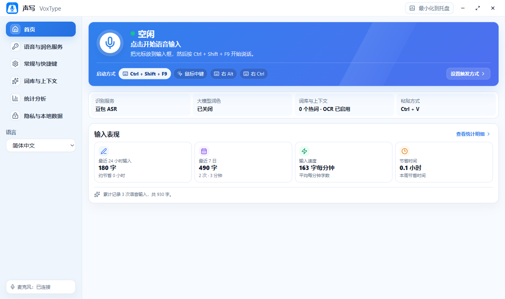

# 声写 VoxType

[English](README.en.md) · [Wiki](https://github.com/zkwi/VoxType/wiki) · [配置指南](docs/wiki/Setup-Guide.md)

## 1. 项目定位与核心特点

VoxType 是开源的 Windows 桌面语音输入工具。把光标放在输入框，开始说话，结束录音后即可把文字输入当前应用。

`快捷键、右 Alt、右 Ctrl 或鼠标中键 → 流式 ASR → 可选 LLM 润色 → 剪贴板粘贴与恢复`

- **实时反馈**：悬浮字幕显示识别进度、耗时状态和错误。正式输出等待服务商返回最终识别结果。
- **可选润色**：短语可以直接输入，长段口述可交给你配置的大模型做轻度整理。
- **术语识别**：可维护热词和场景说明，按需使用当前屏幕或窗口的 OCR 文字辅助识别。
- **原生输入**：支持自动粘贴或仅复制，粘贴后尽量恢复原剪贴板。
- **本地管理**：凭据和设置由用户自己保管。使用统计只记录字数、时长和速度等非正文指标。



## 2. 三步快速开始

1. **安装并启动**。下载最新 Windows x64 安装包 `VoxType_*_x64-setup.exe`，运行安装程序，再从开始菜单启动。支持 Windows 10 和 11。 [下载安装包](https://github.com/zkwi/VoxType/releases/latest)
2. **连接语音识别服务**。打开「语音与润色服务」，选择豆包流式语音识别或阿里云百炼 FunASR，填写该服务的凭据并点击「测试语音识别连接」。豆包推荐新版语音控制台的单 API Key。 [配置指南](docs/wiki/Setup-Guide.md)
3. **开始输入**。将光标放在目标输入框，按默认 `Ctrl + Q` 开始说话，再按一次结束。最终识别完成后，VoxType 会按所选粘贴方式输出。也可在「常规与快捷键 → 启动语音输入」开启右 Alt、右 Ctrl 或鼠标中键。

首页的麦克风状态、启动方式和配置速览可直接打开对应设置。「查看统计明细」可进入统计分析，首页底部显示本地历史的累计输入次数和字数。

### 麦克风与首次输入

- 在 Windows 的「隐私和安全性 → 麦克风」中允许桌面应用访问麦克风。
- 有多个输入设备时，在「常规与快捷键 → 麦克风与录音」选择设备。连接或重连设备后可刷新列表。
- 用一个普通文本框测试首次输入，可以直接观察字幕和最终输出。
- 如果连接测试成功但没有输入，检查目标窗口是否允许粘贴，或改用「仅复制到剪贴板」后手动粘贴。

### 主窗口与托盘

主窗口最小尺寸为 `960 × 640`。关闭按钮默认将应用隐藏到托盘，后台仍可使用已启用的录音触发键。

| 操作 | 效果 |
| --- | --- |
| 左键单击托盘图标 | 打开或恢复主窗口 |
| 右键菜单「打开主窗口」 | 从托盘恢复窗口 |
| 右键菜单「检查更新」 | 打开主窗口并执行一次更新检查 |
| 右键菜单「退出」 | 结束应用 |
| 托盘状态下触发录音，且 ASR 尚未配置 | 打开 语音与润色服务页 |

关闭行为和随 Windows 登录启动可在「常规与快捷键」页设置。登录启动时，配置就绪的应用会留在托盘。

安装、权限或首次配置遇到问题时，按对应场景排查。 [常见问题与排障](docs/wiki/Troubleshooting.md)

### 看懂输入反馈

| 界面提示 | 可以怎么做 |
| --- | --- |
| 首页提示需要配置 | 在 语音与润色服务页补齐当前服务的凭据并测试 |
| 悬浮字幕出现实时文字 | 继续说话，结束后等待最终输出 |
| 悬浮字幕提示麦克风启动失败 | 检查 Windows 权限或输入设备，然后重试 |
| 应用提示文字已复制 | 如目标应用未收到粘贴，可手动按 `Ctrl + V` |

## 3. 配置概览

### 语音与润色服务

| 服务 | 应用内设置 |
| --- | --- |
| 豆包语音控制台 API Key | 填写新版控制台创建的 API Key |
| 豆包旧版控制台 | 填写 App Key 和 Access Key |
| 火山方舟 Agent Plan | 填写 Agent Plan 专属 API Key，使用固定资源规格 |
| 阿里云百炼 FunASR | 填写 API Key 和 Workspace ID，按账户地域选择连接配置 |
| 可选 LLM 润色 | 填写 OpenAI 兼容 Base URL、API Key 和模型名 |

豆包标准接入可在 ASR 高级设置中选择账户已开通的小时版或并发版。不同接入方式的凭据分别保存。

只需要听写时，完成 ASR 配置即可使用。在「语音与润色服务 → 大模型润色」可测试大模型连接、启用润色并设置最小润色字数。在「词库与上下文」可编辑系统提示词和用户提示词模板，也可预览或恢复默认提示词。

大模型润色可选「日常顺滑」「正式成稿」「仅纠错保真」。显示正在润色时，再按一次已启用的触发键可直接输出识别原文。若润色改变了结果，可在首页复制或对照查看原文，预览随隐藏窗口或开始新一轮清除。

从托盘听写并完成润色后，也可以打开首页查看或复制润色前原文。再次隐藏主窗口会清除本次预览。

### 触发方式与输入结果

| 设置 | 默认 | 用法 |
| --- | --- | --- |
| 主快捷键 | 开启，`Ctrl + Q` | 可录制其他组合，也可关闭 |
| 右 Alt | 关闭 | 开启后松开右 Alt 切换录音 |
| 右 Ctrl | 关闭 | 开启后松开右 Ctrl 切换录音 |
| 鼠标中键 | 关闭 | 开启后按下中键切换录音 |
| 粘贴方式 | `Ctrl + V` | 可改为 `Shift + Insert` 或仅复制 |
| 粘贴后恢复剪贴板 | 开启 | 应用会尝试恢复此前内容 |
| 录音时静音系统声音 | 关闭 | 可在麦克风设置开启，录音结束后恢复 |

开启备用触发后，对应按键由 VoxType 接管。使用右 Ctrl 触发时，左 Ctrl 仍可用于复制、粘贴和主快捷键。需要恢复其他应用中的右 Ctrl 组合键时，可关闭该开关。

录制新的主快捷键时，VoxType 会临时暂停备用触发。录制结束或失焦后自动恢复。

录制新的主快捷键时，按下有效组合即可保存。按 Esc 或单按 Tab 离开录制框会保留原组合，带修饰键的 Tab 可以录制。

### 热词、场景与屏幕 OCR

- **热词**适合姓名、产品名、缩写和行业术语。
- **场景说明**适合描述用途和表达偏好，例如技术工单或会议纪要。
- **屏幕 OCR**默认开启。在「词库与上下文 → 屏幕文字上下文」可更改识别范围、测试预览或关闭，并可在高级设置中调整字数上限。
- **最近上下文**默认关闭。开启后可辅助连续输入，是否让大模型参考由单独的开关控制。
- **自动热词候选**默认关闭。开启后可积累本地历史，候选词需要确认后才加入词表。

应用内设置会自动保存。低频参数、字段取值和高级示例集中在配置模板与功能指南。 [配置模板](config.example.toml) · [功能指南](docs/wiki/Feature-Guide.md)

### 按场景选择设置

- 写短消息时，可以只配置 ASR。需要整理会议纪要时，再打开大模型润色并调整触发长度。
- 应用已占用 `Ctrl + Q` 时，可录制其他组合，或者只启用一种备用触发。
- 一边查阅资料一边输入时，可保留当前显示器 OCR。只需参考输入窗口时，可缩小到当前窗口。
- 使用远程桌面或限制自动粘贴的应用时，可试用仅复制模式。

## 4. 隐私与本地数据

下表为安装版的默认位置。旧配置或统计文件可能沿用此前的位置，实际使用位置可在「隐私与本地数据」查看。

| 数据 | 默认位置 | 内容与默认行为 |
| --- | --- | --- |
| 配置 | `%APPDATA%\VoxType\config.toml` | 保存设置，可能包含用户填写的 API 凭据 |
| 日志 | `%LOCALAPPDATA%\VoxType\logs\voice_input.log` | 记录脱敏运行事件，排除识别正文和真实密钥 |
| 使用统计 | 安装目录下的 `voice_input_stats.jsonl` | 记录时间、字数、时长和速度等非正文数据 |
| 最近上下文 | 配置目录下的 `context/recent_context.jsonl` | 默认关闭，开启后保存最近识别片段 |
| 自动热词历史 | 配置目录下的 `context/hotword_history.jsonl` | 默认关闭，开启后保存生成候选所用的本地文本历史 |

### 数据何时发往云端

| 启用的能力 | 发往所选服务的数据 |
| --- | --- |
| 语音识别 | 本次录音及按设置启用的热词、场景、OCR 和最近上下文 |
| 大模型润色 | 达到触发长度的最终识别文本及启用的参考信息 |
| 手动生成热词候选 | 用于提取候选词的本地历史片段 |

屏幕 OCR 在 Windows 本地执行。开启该功能时，提取的相关文字可随本次请求发送。剪贴板快照用于当前粘贴流程，最近一次识别结果的首页预览可随时清空。

「隐私与本地数据」提供最近上下文、自动热词历史和统计的清空入口。云端数据留存由服务商管理。

### 本地隐私开关

- 想避免附带屏幕文字和最近输入时，可关闭屏幕 OCR，并保持最近上下文关闭。
- 允许 ASR 参考最近输入时，可单独开启最近上下文。润色服务参考前文需要额外授权。
- 如果选择记录自动热词历史，可在生成候选词后按需清空历史。

提交反馈时可从「常规与快捷键」页复制脱敏诊断报告。请先检查附件或截图是否包含个人数据。 [安全与隐私报告](SECURITY.md)

## 5. 开发与本地检查

在 Windows 开发机准备以下环境。

- Node.js 22.17 或更高版本，以及 npm。
- Rust stable 和 Cargo，使用 Windows MSVC 工具链。
- Visual Studio C++ Build Tools、Windows SDK 和 Microsoft Edge WebView2 Runtime。

### 安装依赖与开发运行

在仓库根目录执行：

```powershell
npm install
npm run tauri dev
```

开发版使用仓库目录中的本地配置。可参照 `config.example.toml` 创建自己的 `config.toml`，其中的服务密钥应留在本机。

### 综合检查与构建

```powershell
npm run ai:check
npm run build
```

`ai:check` 覆盖前端类型和单测、Rust 格式及测试、治理检查和密钥扫描。`build` 生成前端静态资源。需要 Windows 安装包时，按维护指南运行发布预检和 Tauri 构建。

| 单独检查 | 命令 |
| --- | --- |
| 前端类型 | `npm run check` |
| 前端单测 | `npm run test:unit` |
| 文档与版本一致性 | `npm run check:governance` |
| 密钥扫描 | `npm run scan:secrets` |

- [参与贡献](CONTRIBUTING.md) · [架构说明](ARCHITECTURE.md)
- [工程维护指南](docs/maintenance-guide.md) · [文档索引](docs/README.md)
- [更新日志](CHANGELOG.md) · [公开路线图](ROADMAP.md)

## 6. 开源协议与第三方服务

VoxType 基于 MIT 协议开源。你可以使用、修改和分发软件，须保留版权与许可声明。软件按原样提供，不附带担保。 [MIT License](./LICENSE)

VoxType 的桌面客户端在本机运行，直接连接你选择的服务商，不内置商业中转后端。豆包语音、阿里云百炼 FunASR 和可选大模型服务分别管理自己的 API 凭据、计费与数据处理。使用前请查看对应服务条款和隐私政策。

使用问题、功能建议和安全报告可从对应入口提交。 [支持说明](SUPPORT.md) · [问题反馈](https://github.com/zkwi/VoxType/issues) · [安全报告](SECURITY.md)
